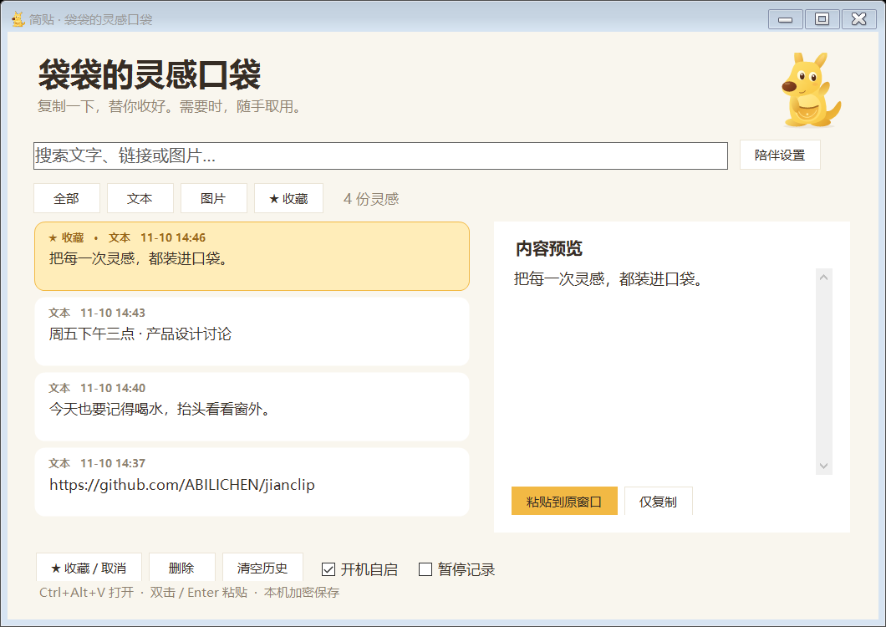
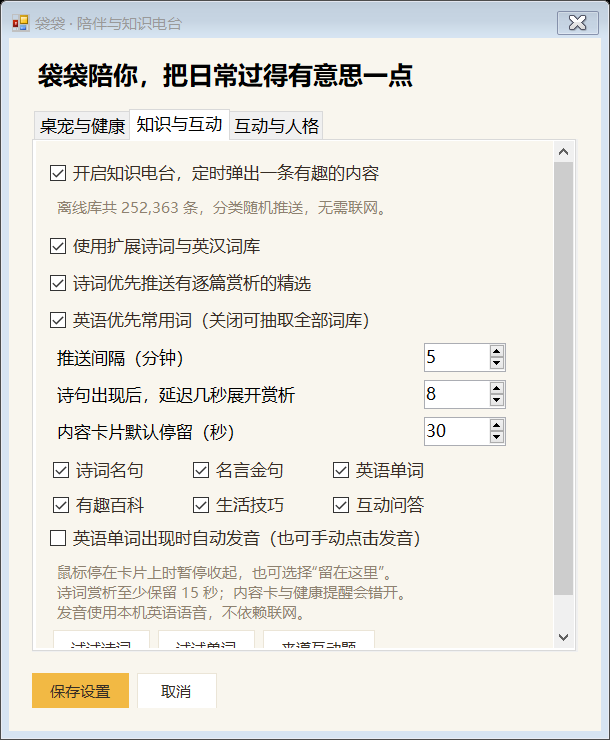
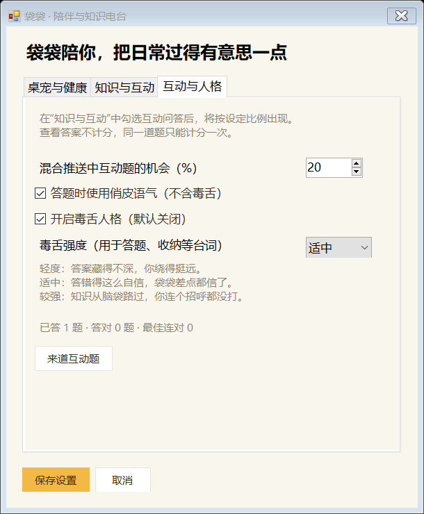
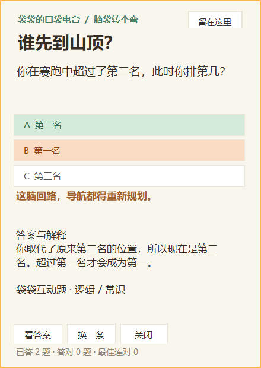
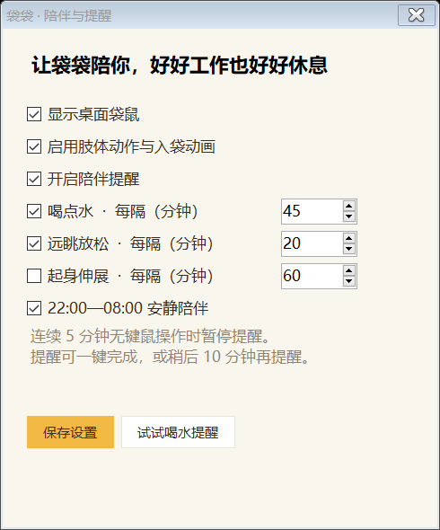

# 简贴 · 袋袋的灵感口袋，主动学习不如被动接受，这款软件将极大增强小初高学生的语文英语等各个方面的能力，同时提供剪贴板功能，开来请俺喝咖啡吧，文末扫码请哦！！！

Windows 10/11 剪贴板管理器 + 小袋鼠桌宠。复制一下，袋袋替你收好；需要时，随手取用。主动学习不如被动接受，这款软件将极大增强小初高学生的语文英语等各个方面的能力

[下载最新版本](https://github.com/ABILICHEN/jianclip/releases/latest)

## v0.3.0 · 离线知识电台与多样人格

每隔自己设定的时间，让袋袋送来一句诗、一个新词或一道小题。默认每 5 分钟推送，诗词出现 8 秒后展开赏析；两个时间都可修改。

- **252,363 条离线内容**：76,676 首扩展唐诗宋词、175,605 个扩展英汉词条，以及 82 条精选内容（16 首带逐篇赏析的诗词、12 条古典金句、24 张原创例句词卡、8 条百科、10 条生活建议和 12 道互动题）。扩展词库中有 16,377 个优先常用词。
- **断网可用**：所有文字、中文释义、原库音标均随 EXE 打包。点击“发音”使用 Windows 本机英语语音；也能开启自动发音。未安装英语语音时会显示提示，词义与音标仍可阅读。已在本机验证离线语音合成。
- **诗词分两段读**：先看诗句，按自定义延迟展开。精选作品有原创逐篇赏析；批量古诗明确标为“原诗与阅读提示”，不冒充专门赏析。默认优先精选，关闭优先后可更多抽取扩展库。
- **互动与成绩**：问题选项随机排序；作答后给出答案和解释，记录答题数、答对数、连对纪录。看答案不计分，同题重复点击不会刷分。互动题比例可设为 0–100%；只选择互动题时则连续提供互动题。
- **毒舌人格可选**：在“陪伴设置 → 互动与人格”中开启，默认关闭。提供轻度、适中、较强三档，用于答错、收纳和知识推送台词。普通俏皮语气与毒舌人格分别控制。
- **少打扰**：卡片不抢焦点；鼠标悬停暂停收起，也可点击“留在这里”。保留卡片期间暂缓其他自动弹窗，关闭后恢复。支持分类开关、常用词优先、扩展库开关；夜间、闲置与其他弹窗期间自动错开推送。
- **按需读取**：扩展库分为 506 个压缩分块，程序只读取索引和正在使用的分块，无需启动时把全部内容载入。

| 知识推送设置 | 毒舌与互动设置 |
| --- | --- |
|  |  |

| 诗词赏析 | 英语词卡 | 互动反馈 |
| --- | --- | --- |
|  |  |  |

设置路径：主窗口“陪伴设置”。“知识与互动”设置间隔 1–240 分钟、赏析延迟 1–120 秒、停留时间 10–180 秒，以及内容分类；“互动与人格”设置题目比例、毒舌开关和强度。保存后生效，试用按钮使用已保存的设置。

精选内容以洗牌方式抽取，扩展库随机按需抽取并避免相邻重复；不会为几十万条内容逐一保存阅读历史。关闭夜间安静后，夜间也可推送。应用关闭期间不计时，恢复后不会补发大量过期卡片。

第三方内容来源与完整 MIT 许可见 [THIRD_PARTY_NOTICES.md](THIRD_PARTY_NOTICES.md) 和 licenses 目录。诗词经简体转写、完整性校验与基础清理；英汉词库过滤无音标、无中文释义、部分不适合桌面随机展示的词条。批量整理仍可能存在原库错误、古籍异文和词义/口音差异，卡片提供来源入口。百科和生活技巧保持精选，不用未核实的批量内容凑数。

成绩存放在 %LOCALAPPDATA%/JianClip/knowledge-progress.json，不上传到任何服务器。运行软件无需网络，仅在用户点击内容来源时打开浏览器。

验证：55 项核心检查 + 12 项桌面集成检查已通过；另对 252,281 条扩展条目逐条校验 ID、必需字段与分块数量，并验证本机离线英语音频可生成。计时、诗词延时展开、互动计分和卡片不抢前台均有检查。截图均为合成内容，毒舌截图为主动开启后的示例。

## 袋袋会做什么

- **复制入袋**：复制文本或图片，小纸片从鼠标附近飞向袋鼠口袋，袋袋开心跳跃。
- **悬停取用**：停在袋鼠身上约半秒，展开最近 5 条内容（收藏优先），单击即可粘贴到之前的窗口。面板不抢焦点，移开后自动收起。
- **拖放收纳**：选中文字并拖到袋鼠身上即可加入历史；历史列表中的文字也可以拖入袋鼠口袋。暂停记录期间不收纳拖放内容。
- **自由摆放**：按住袋鼠拖动，位置自动保存，兼容负坐标的多显示器桌面。右键可以管理历史、设置提醒、隐藏或退出。
- **动作陪伴**：呼吸、眨眼、挥手、开心跳跃、喝水、远眺、伸懒腰、闲置闭眼。形象用原创矢量代码实时绘制，动作不依赖网络或外部资源。
- **温柔提醒**：默认喝水 45 分钟、远眺 20 分钟；可额外开启起身伸展。间隔可设为 1–240 分钟。支持完成和稍后 10 分钟；22:00–08:00 与连续 5 分钟未操作时安静陪伴。
- **剪贴板管理**：搜索、文本/图片分类、收藏、预览、删除、清空、仅复制、快捷键粘贴、暂停记录、托盘与开机自启。

| 快速口袋 | 陪伴设置 |
| --- | --- |
|  |  |

## 开始使用

1. 从 Release 下载 JianClip-portable.zip，解压到固定目录。也可以仅下载单文件 JianClip.exe。
2. 双击 JianClip.exe，桌面右下角出现黄色小袋鼠。
3. 正常 Ctrl+C / Ctrl+X 复制文本或图片；悬停袋鼠后点选历史，或在输入框按 Ctrl+Alt+V 呼出完整管理器，双击 / Enter 粘贴。
4. 主窗口勾选“开机自启”，下次登录 Windows 后后台启动。移动 EXE 后请取消并重新勾选，更新路径。
5. 关闭主窗口会继续在托盘运行；右键袋鼠或托盘点“退出简贴”结束程序。隐藏袋鼠后可从托盘重新显示。

需要 .NET Framework 4.8（多数 Windows 10/11 已安装），不需要管理员权限，不需要联网。

## 更新旧版

先从旧版托盘退出简贴，再用新 EXE 替换原文件。保留原来的运行路径即可继续使用开机自启。旧版加密历史可直接读取。首次更新如果更换了路径，请重新设置自启。

## 数据与限制

- 历史：%LOCALAPPDATA%/JianClip/history.dat，使用 Windows DPAPI 当前用户加密。设置与位置：同目录 settings.json。内容不会上传至 GitHub，无联网、云同步或遥测代码。
- 最多 200 条、总内容约 1600 万字符；优先移除最旧的非收藏内容。收藏占满时拒收新片段。单张 PNG 上限 4 MB，文本上限 50 万字符。
- 保存纯文本和图片，不保留 HTML/RTF 样式、资源管理器文件复制、OCR 搜索。
- 遵守 ExcludeClipboardContentFromMonitorProcessing 与 CanIncludeInClipboardHistory=0 隐私标记。未带标记的敏感文字仍可能被保存，处理此类内容时可开启暂停记录。
- 自动粘贴受 Windows 前台切换与权限限制；管理员窗口、部分游戏和特殊编辑器可能需要“仅复制”后手动 Ctrl+V。目标窗口发生变化时会保留复制内容并提示手动粘贴。
- “远眺约 20 秒”是提醒文案，不会锁屏或强制倒计时。提醒以本机时间计算，程序关闭期间不计时。夜间安静时段固定为 22:00–08:00，可关闭夜间安静。
- 私有仓库的 Release 仅限有仓库权限的用户下载。

## 构建与验证

运行 build.ps1 编译，test.ps1 执行核心检查，test.ps1 -Integration 执行需要交互桌面的集成检查（临时使用并恢复系统剪贴板）。

使用 Windows 自带 .NET Framework C# 编译器，无 NuGet、Node 或 Python 运行依赖。输出 dist/JianClip.exe。

v0.2.0 已通过 22 项核心检查和 7 项桌面集成检查：加密、去重、收藏容量、隐私标记、设置、提醒时序、稍后提醒、透明动作渲染、真实文本与图片剪贴板监听、暂停、程序自身复制去重、快速面板不抢焦点和退出释放。

截图由程序以合成示例内容渲染，未包含用户剪贴板数据。UI 自动化工具在本机还原窗口时报告异常，因此实际鼠标拖放、跨应用自动粘贴及重启登录后的自启仍需用户环境验收。

开发预览：--demo 使用独立临时目录和示例记录，不监听真实剪贴板；--render-preview 输出示例界面 PNG；--export-art 导出七种动作 PNG。这些开发选项不改变正式数据。

## 调研参考

本项目独立实现，没有复制其它美术资源
